# Big-O Arcade

A Godot 4 game for building intuition about data structures and algorithms. Twelve hands-on levels, one boss round, and a cheat sheet, all aimed at a single skill: looking at code and knowing how the work grows when the data grows.


<p align="center">
  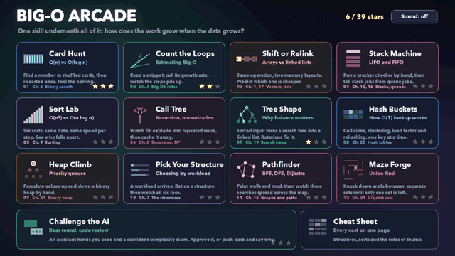
  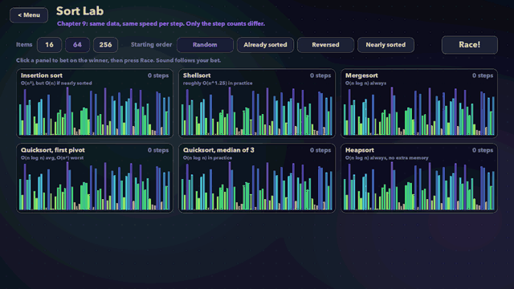
</p>
<p align="center">
  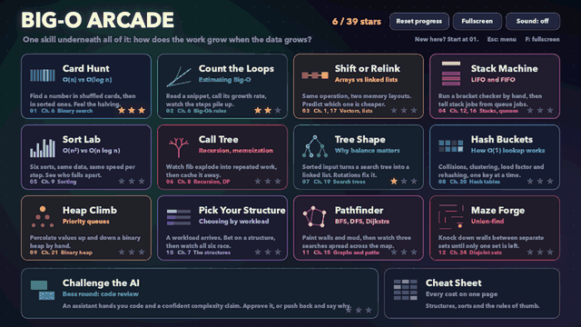
  
</p>

## Why this exists

I wanted a foundation in data structures and algorithms that was good enough to push back on AI-written code when it makes a confident claim about performance. Reading a textbook got me the vocabulary. Playing with the ideas got me the intuition.

Each level takes one idea and makes you do it with your hands: flip the cards, make the swap, pick the structure, paint the wall. The explanation comes after you have felt the cost.

## Run it

You need [Godot 4](https://godotengine.org/download). There is nothing to build and no assets to import.

```bash
git clone https://github.com/SebbyTeaDev/big-o-arcade.git
godot --path big-o-arcade
```

Or open `project.godot` in the Godot editor and press F5.

Built and tested on Godot 4.7.1 on macOS. It uses HDR 2D with glow, so it wants a recent 4.x release; older versions are untested.

| Key | Action |
|---|---|
| Mouse | Everything |
| Esc | Back to the menu |

Progress (one to three stars per level) is saved to Godot's user data folder.

## The levels

| # | Level | What you do | What you take away |
|---|---|---|---|
| 1 | **Card Hunt** | Find a number in shuffled cards, then in sorted ones, up to 512 | O(n) vs O(log n): doubling the data adds one look |
| 2 | **Count the Loops** | Call the Big-O of 14 code snippets | Loops in a row add, nested loops multiply, library calls hide loops |
| 3 | **Shift or Relink** | Predict whether an array or a linked list does an operation in fewer steps | Contiguous memory vs pointers, and what "amortized O(1)" means |
| 4 | **Stack Machine** | Run a bracket checker by hand, then sort stack jobs from queue jobs | LIFO and FIFO are about order, not speed |
| 5 | **Sort Lab** | Race six sorts on the same data and bet on the winner | O(n²) vs O(n log n), and how input order breaks naive quicksort |
| 6 | **Call Tree** | Watch `fib` explode into repeated work, then turn on caching | Exponential recursion and why dynamic programming exists |
| 7 | **Tree Shape** | Feed a search tree sorted data, then switch on self-balancing | A lookup costs the height of the tree |
| 8 | **Hash Buckets** | Insert keys, watch them collide and cluster, then rehash | O(1) lookup depends on load factor and a decent hash |
| 9 | **Heap Climb** | Do the percolate-up and percolate-down swaps yourself | A heap is a tree stored in a plain array |
| 10 | **Pick Your Structure** | Bet on one of six structures for seven workloads, then watch them race | No structure wins everywhere |
| 11 | **Pathfinder** | Paint walls and mud, then run BFS, DFS and Dijkstra | The frontier's data structure is the algorithm |
| 12 | **Maze Forge** | Build a maze with union-find, ask "are these connected?", then solve it | Near-constant-time set merging |
| Boss | **Challenge the AI** | An assistant hands you code and a complexity claim: approve or push back | Which claims to check, and what to ask for instead |

There is also a one-page **Cheat Sheet** with the cost of every operation in the game.

## Gallery

<table>
  <tr>
    <td width="33%">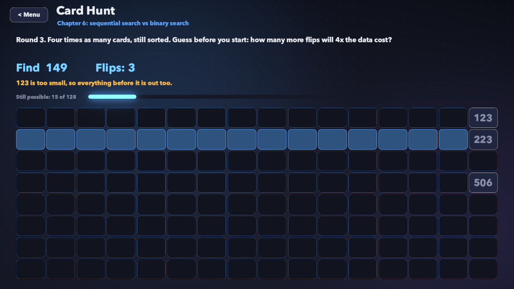<br><sub><b>Card Hunt</b>: three flips rule out 113 of 128 cards</sub></td>
    <td width="33%">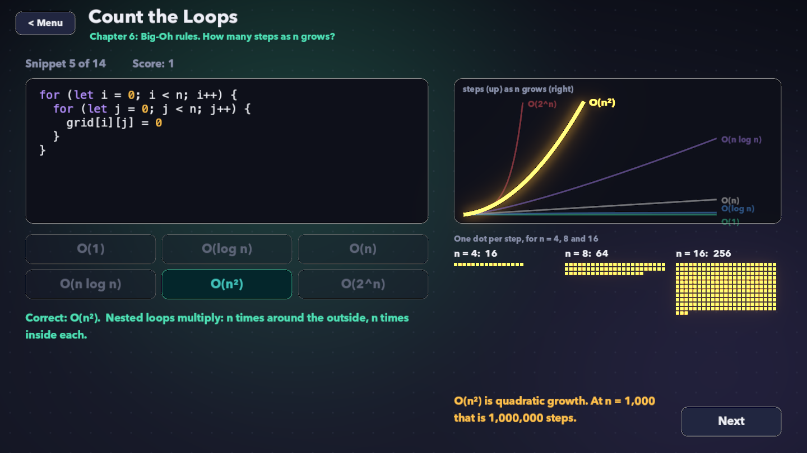<br><sub><b>Count the Loops</b>: one dot per step</sub></td>
    <td width="33%"><br><sub><b>Shift or Relink</b>: inserting in the middle</sub></td>
  </tr>
  <tr>
    <td><br><sub><b>Stack Machine</b>: you are the bracket checker</sub></td>
    <td>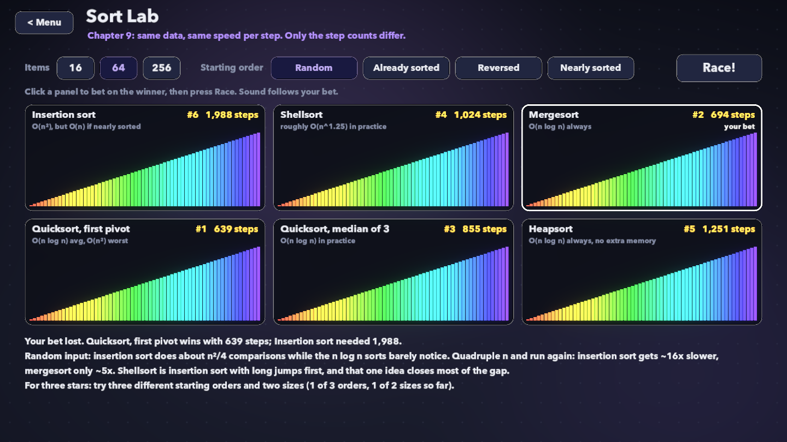<br><sub><b>Sort Lab</b>: same data, same speed per step</sub></td>
    <td><br><sub><b>Call Tree</b>: same colour, same question</sub></td>
  </tr>
  <tr>
    <td>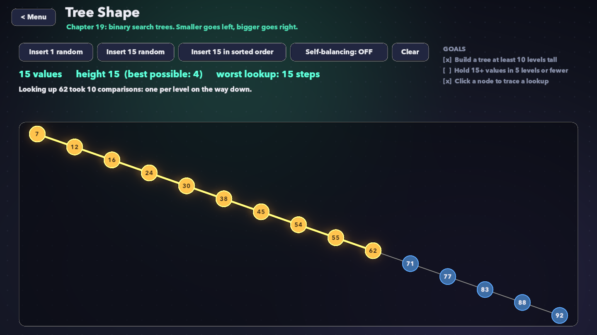<br><sub><b>Tree Shape</b>: sorted input makes a linked list</sub></td>
    <td>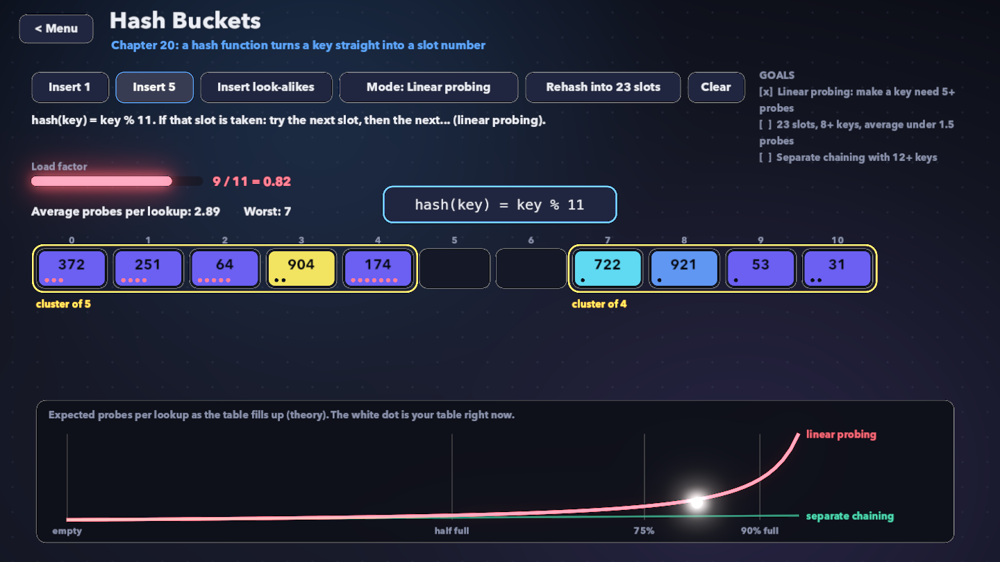<br><sub><b>Hash Buckets</b>: a cluster, and the theory curve</sub></td>
    <td>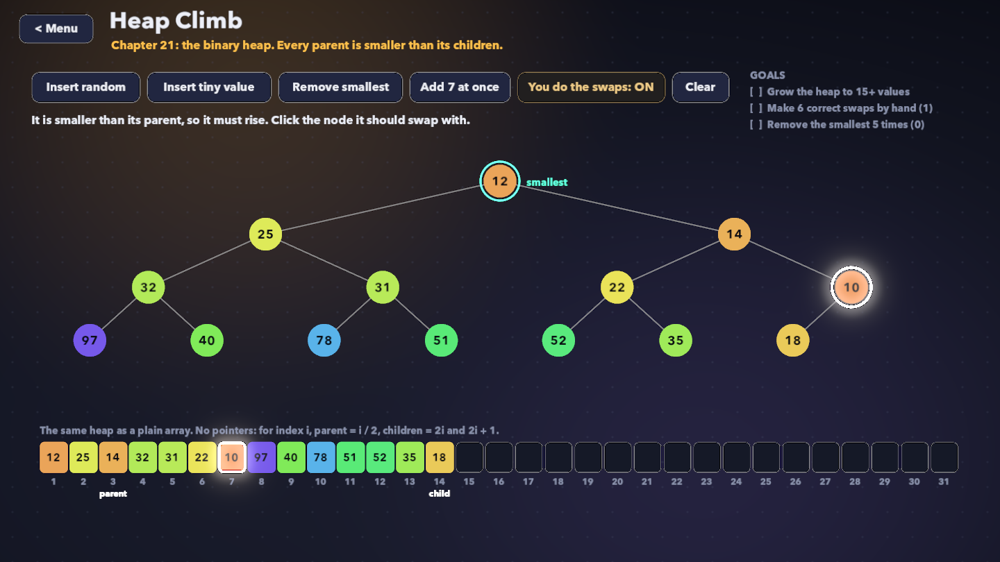<br><sub><b>Heap Climb</b>: tree on top, the same array below</sub></td>
  </tr>
  <tr>
    <td>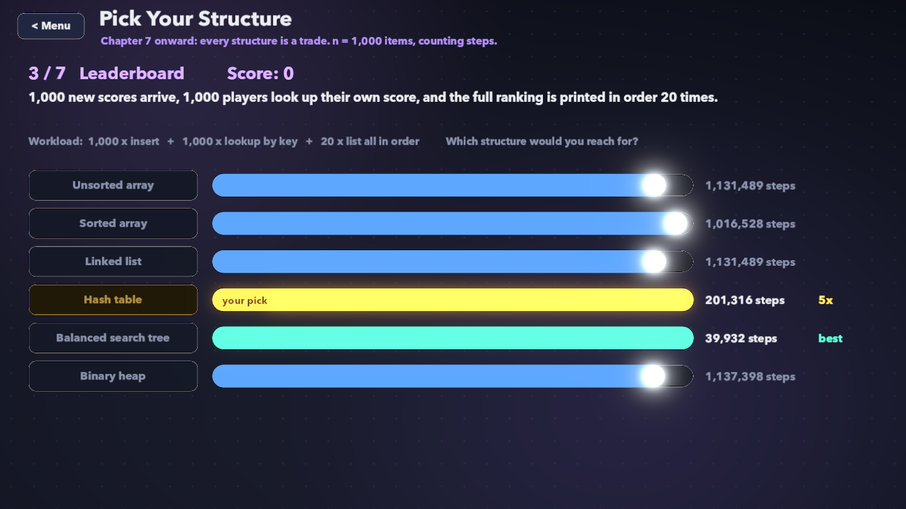<br><sub><b>Pick Your Structure</b>: the leaderboard workload</sub></td>
    <td><br><sub><b>Pathfinder</b>: Dijkstra walks around the mud</sub></td>
    <td>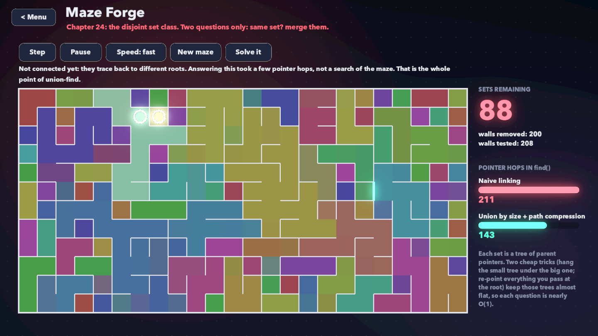<br><sub><b>Maze Forge</b>: each colour is one set</sub></td>
  </tr>
  <tr>
    <td><br><sub><b>Challenge the AI</b>: the hidden cost of <code>shift()</code></sub></td>
    <td><br><sub><b>Cheat Sheet</b></sub></td>
    <td></td>
  </tr>
</table>

## How it is built

The whole game is GDScript, about 4,500 lines, with no image, font or audio files.

- **Everything is drawn in code.** Each level is one script that extends `levels/level_base.gd` and paints itself in `_draw()`. The only scene file is a four-line `main.tscn`.
- **Glow is real bloom.** The project renders 2D in HDR. Any colour brighter than 1.0 blooms, so `UI.hot(colour)` is all it takes to make something glow.
- **Sound is synthesised at startup.** Five short tones are generated into `AudioStreamWAV` buffers and pitched at play time. In Sort Lab the pitch follows the value being moved.
- **The algorithms are the real ones.** Sort Lab records every comparison and write from actual implementations and replays them at a fixed number of steps per second, so a race is an honest count. The AVL rotations, binary heap, hash probing, union-find and graph searches all run for real.

```
main.gd              menu, save file, sound, background shader, test harness
ui.gd                palette, fonts, drawing helpers, syntax highlighter
icons.gd             animated menu icons
menu_card.gd         one card on the menu
levels/
  level_base.gd      header, timing, particles, shake, star toast
  search.gd  bigo.gd  listarr.gd  stackq.gd  sortlab.gd  recursion.gd
  tree.gd  hash.gd  heap.gd  race.gd  graph.gd  maze.gd
  boss.gd  sheet.gd
```

### Adding a level

1. Create `levels/yourlevel.gd` that extends `res://levels/level_base.gd`.
2. Call `header("subtitle")` in `_ready()`, draw in `_draw()`, and put per-frame logic in `tick(delta)`.
3. Call `finish(stars)` when the player earns one to three stars.
4. Add an entry to `LEVELS` in `main.gd`. The `id` must match the file name.

## Testing

The game carries its own small test harness, driven by real mouse events.

```bash
# Play a scripted demo of every level and save a screenshot of each
godot --path . -- --shots=/some/folder

# Same, for one level
godot --path . -- --shots=/some/folder --only=graph

# Smoke test: 900 random clicks on every screen, watching for script errors
godot --path . -- --monkey
```

Neither mode touches your save file. The GIFs above were recorded by combining the demo mode with Godot's `--write-movie`.

## Simplifications

The numbers in the game are meant to build intuition, so a few things are rounded off:

- Hash table costs are averages. The worst case is O(n).
- In Pick Your Structure, "get item #i" means position in insertion order, and the sorted array is assumed to keep its smallest item at the end.
- Shift or Relink counts logical steps. On real hardware arrays usually beat linked lists by more than the step count suggests, because contiguous memory is kind to the CPU cache.

## Credits

The level order and chapter references follow Mark Allen Weiss, *Data Structures and Problem Solving Using C++* (2nd edition). The game's code, text and visuals are original.

Thanks to the coworkers who pointed me at the book and summed the subject up in one line: estimating the complexity of an algorithm is the skill, and everything else is a bonus.
