# Big-O Arcade

A Godot 4 game for building intuition about data structures and algorithms. Twelve hands-on levels, one boss round, a step-through code viewer and a cheat sheet, all aimed at a single skill: looking at code and knowing how the work grows when the data grows.

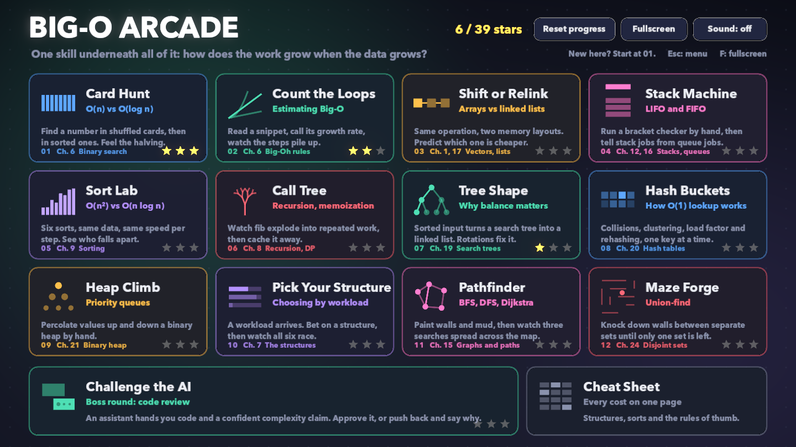

<p align="center">
  
  
</p>
<p align="center">
  
  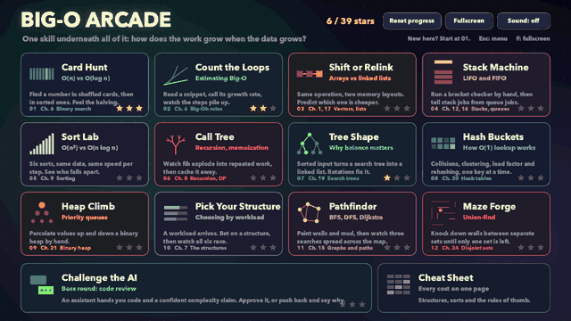
</p>

## Why this exists

I wanted a foundation in data structures and algorithms that was good enough to push back on AI-written code when it makes a confident claim about performance. Reading a textbook got me the vocabulary. Playing with the ideas got me the intuition.

Each level takes one idea and makes you do it with your hands: flip the cards, make the swap, pick the structure, paint the wall. The explanation comes after you have felt the cost.

## Run it

You need [Godot 4](https://godotengine.org/download). There is nothing to build and no assets to import.

```bash
git clone https://github.com/SebbyTeaDev/big-o-arcade.git
godot --path big-o-arcade
```

Or open `project.godot` in the Godot editor and press F5.

Built and tested on Godot 4.7.1 on macOS, under both the Forward+ and Compatibility renderers. It uses HDR 2D with glow, so it wants a recent 4.x release. Older versions, Windows and Linux are untested.

| Input | Action |
|---|---|
| Mouse | Everything |
| Esc | Back to the menu, or close a briefing or the code viewer |
| Enter | Next, when a Next button is showing |
| 1 to 6 | Pick an answer in Count the Loops |
| Right / Space, Left | Step forward and back in the code viewer |
| F or F11 | Fullscreen |

Progress (one to three stars per level) is saved to Godot's user data folder. The menu has a reset button.

## Step through the code

Wherever the game shows code, you can run it. The code viewer is a small debugger: it highlights the line that just ran, counts the stops on each line, shows the variables and the data, explains each step in plain English, and keeps a running total of the work done.

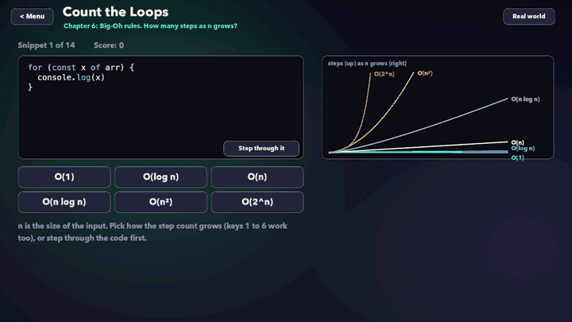

Library calls that hide a loop, like `includes()`, `indexOf()`, `find()` and `shift()`, are unrolled so you can watch the scan happen. Run a snippet to the end and the viewer fills in the totals for three input sizes, which is usually all it takes to see the growth rate for yourself.

There are 30 runnable snippets: every one in Count the Loops and Challenge the AI, plus the algorithm behind each hands-on level (binary search, insertion sort, the bracket checker, heap insert, hash probing, breadth-first search, union-find and more).

<table>
  <tr>
    <td width="50%">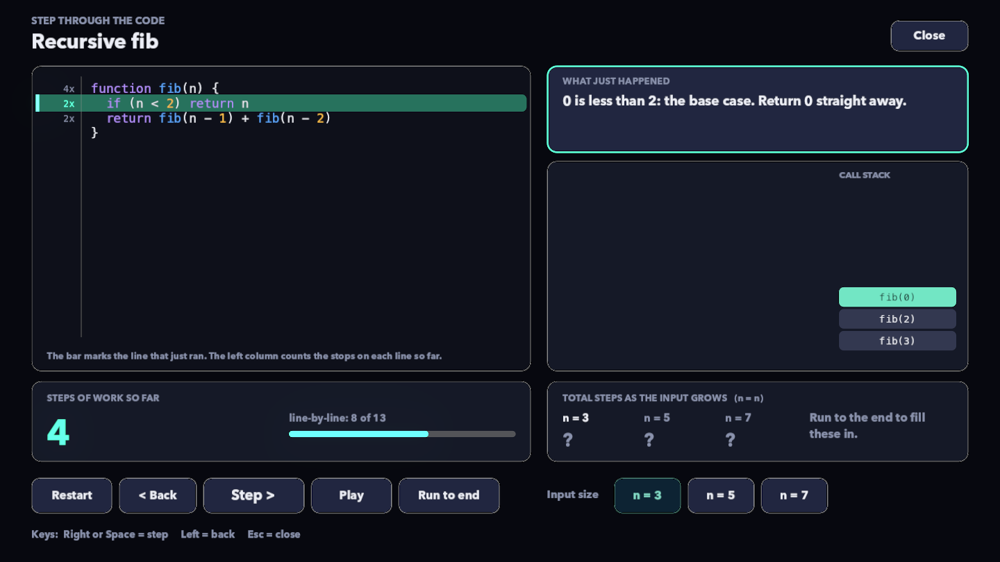<br><sub>Recursive <code>fib</code>, with the call stack</sub></td>
    <td width="50%">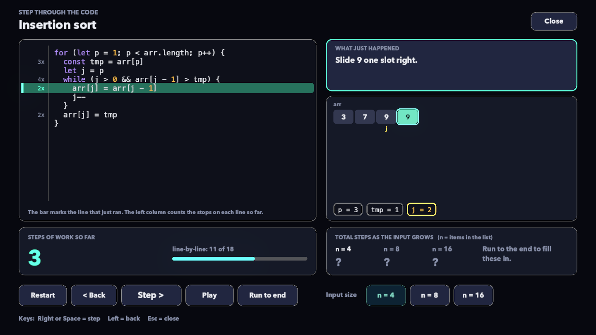<br><sub>Insertion sort, mid-slide</sub></td>
  </tr>
</table>

## Where it shows up in real software

Every level opens with a short briefing: how to play, three places the idea turns up in real systems, and an animated picture of one of them. You can reopen it any time with the **Real world** button.

<table>
  <tr>
    <td width="33%">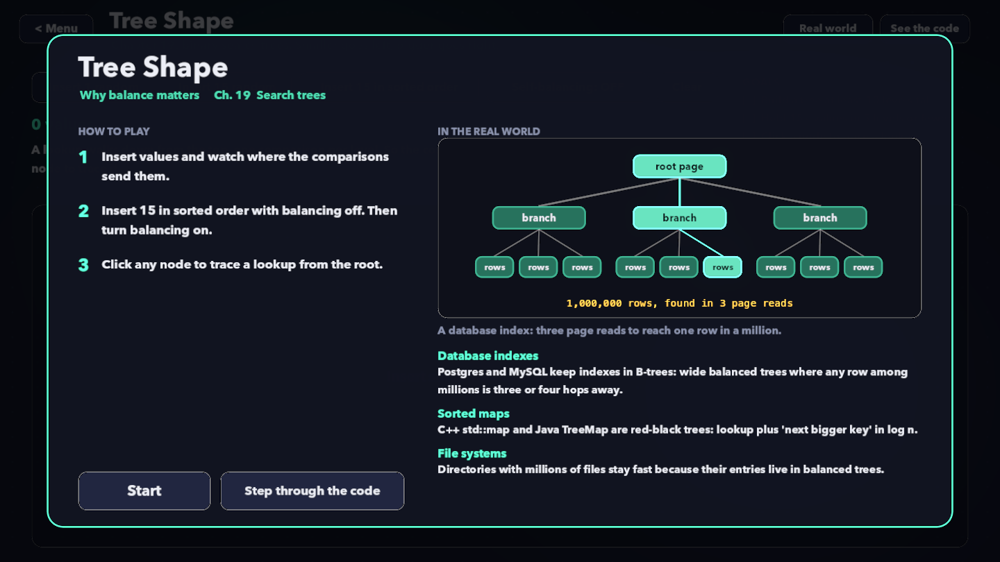<br><sub>Balanced trees: a database index</sub></td>
    <td width="33%">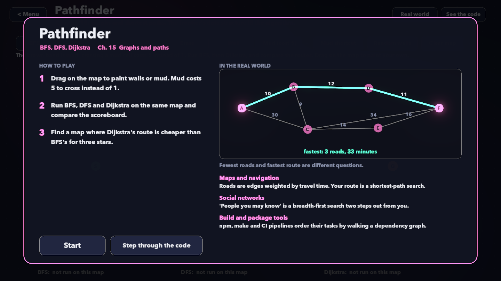<br><sub>Shortest paths: navigation</sub></td>
    <td width="33%">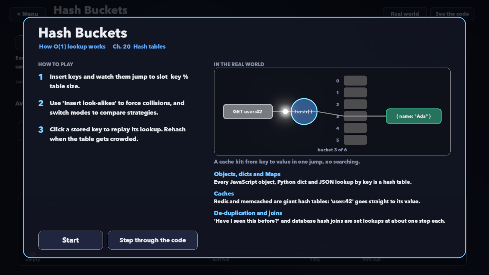<br><sub>Hash tables: a cache hit</sub></td>
  </tr>
</table>

## The levels

| # | Level | What you do | Real-world example |
|---|---|---|---|
| 1 | **Card Hunt** | Find a number in shuffled cards, then in sorted ones, up to 512 | `git bisect` |
| 2 | **Count the Loops** | Call the Big-O of 14 snippets, or run them first | The endpoint that was fine in testing |
| 3 | **Shift or Relink** | Predict whether an array or a linked list is cheaper | "Play next" in a playlist |
| 4 | **Stack Machine** | Run a bracket checker by hand, then sort stack jobs from queue jobs | The Back button and the print queue |
| 5 | **Sort Lab** | Race six sorts on the same data and bet on the winner | Clicking a column header |
| 6 | **Call Tree** | Watch `fib` explode into repeated work, then turn on caching | Adding up folder sizes |
| 7 | **Tree Shape** | Feed a search tree sorted data, then switch on self-balancing | A database index |
| 8 | **Hash Buckets** | Insert keys, watch them collide and cluster, then rehash | A cache lookup |
| 9 | **Heap Climb** | Do the percolate-up and percolate-down swaps yourself | A job scheduler |
| 10 | **Pick Your Structure** | Bet on one of six structures for seven workloads | The structures inside one web app |
| 11 | **Pathfinder** | Paint walls and mud, then run BFS, DFS and Dijkstra | Route planning |
| 12 | **Maze Forge** | Build a maze with union-find, then solve it | "Can server A reach server B?" |
| Boss | **Challenge the AI** | An assistant hands you code and a complexity claim: approve or push back | Pull request review |

There is also a one-page **Cheat Sheet** with the cost of every operation in the game.

## Gallery

<table>
  <tr>
    <td width="33%"><br><sub><b>Card Hunt</b>: three flips rule out 113 of 128 cards</sub></td>
    <td width="33%"><br><sub><b>Count the Loops</b>: one dot per step</sub></td>
    <td width="33%">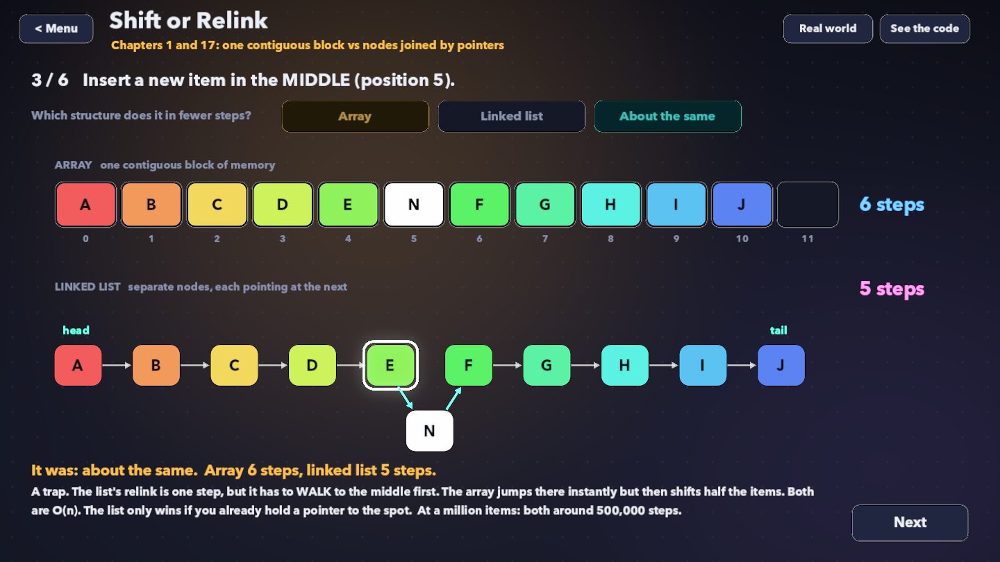<br><sub><b>Shift or Relink</b>: inserting in the middle</sub></td>
  </tr>
  <tr>
    <td>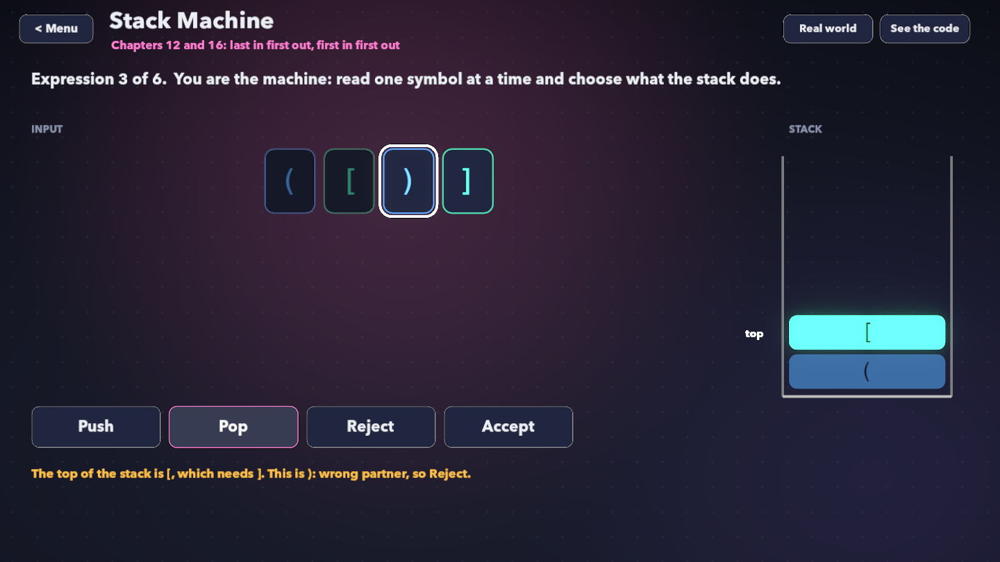<br><sub><b>Stack Machine</b>: you are the bracket checker</sub></td>
    <td><br><sub><b>Sort Lab</b>: same data, same speed per step</sub></td>
    <td>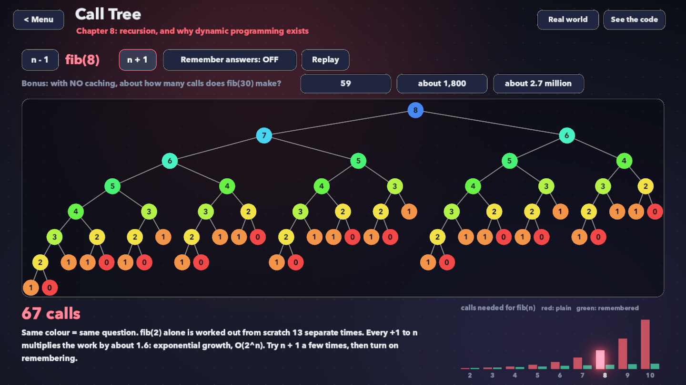<br><sub><b>Call Tree</b>: same colour, same question</sub></td>
  </tr>
  <tr>
    <td><br><sub><b>Tree Shape</b>: sorted input makes a linked list</sub></td>
    <td><br><sub><b>Hash Buckets</b>: a cluster, and the theory curve</sub></td>
    <td><br><sub><b>Heap Climb</b>: tree on top, the same array below</sub></td>
  </tr>
  <tr>
    <td><br><sub><b>Pick Your Structure</b>: the leaderboard workload</sub></td>
    <td>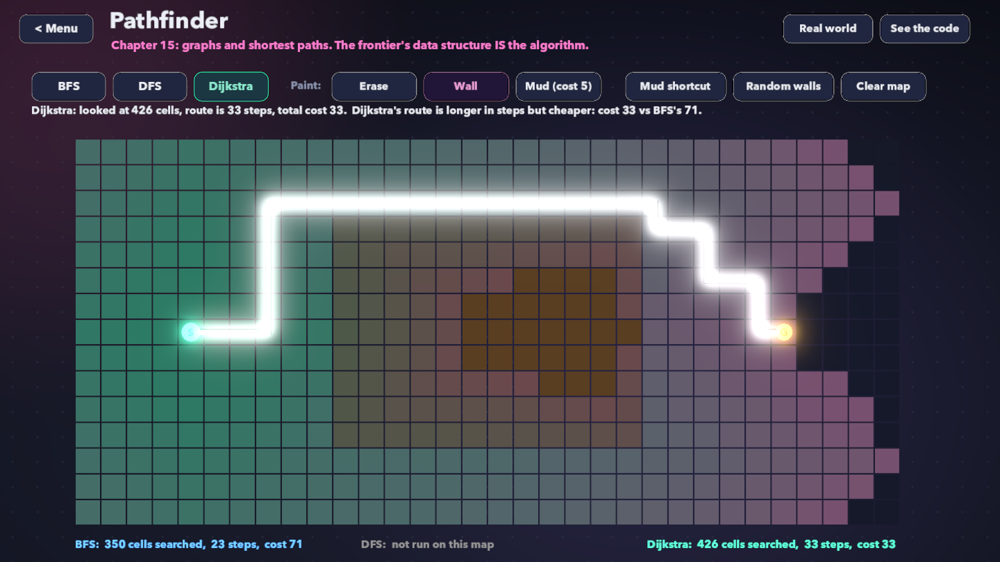<br><sub><b>Pathfinder</b>: Dijkstra walks around the mud</sub></td>
    <td><br><sub><b>Maze Forge</b>: each colour is one set</sub></td>
  </tr>
  <tr>
    <td>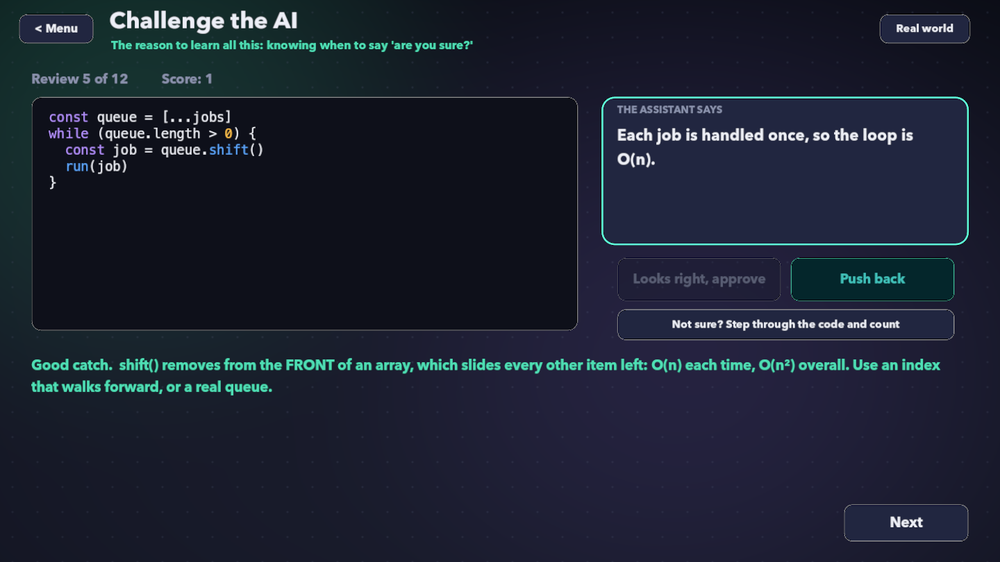<br><sub><b>Challenge the AI</b>: the hidden cost of <code>shift()</code></sub></td>
    <td>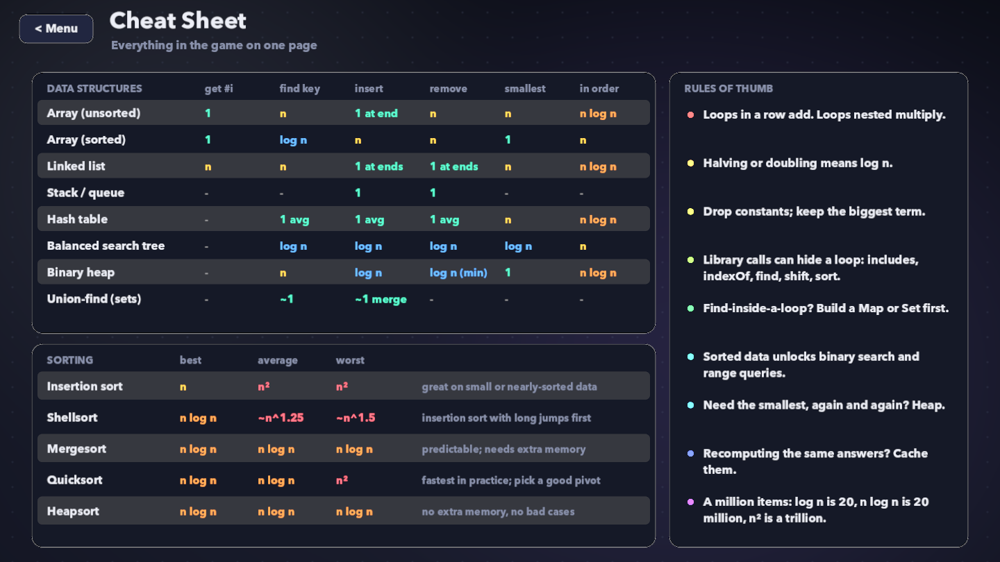<br><sub><b>Cheat Sheet</b></sub></td>
    <td></td>
  </tr>
</table>

## How it is built

The whole game is GDScript, about 6,300 lines, with no image, font or audio files.

- **Everything is drawn in code.** Each level is one script that extends `levels/level_base.gd` and paints itself in `_draw()`. The only scene file is a four-line `main.tscn`.
- **Glow is real bloom.** The project renders 2D in HDR. Any colour brighter than 1.0 blooms, so `UI.hot(colour)` is all it takes to make something glow.
- **Sound is synthesised at startup.** Five short tones are generated into `AudioStreamWAV` buffers and pitched at play time. In Sort Lab the pitch follows the value being moved.
- **The algorithms are the real ones.** Sort Lab records every comparison and write from actual implementations and replays them at a fixed number of steps per second, so a race is an honest count. The AVL rotations, binary heap, hash probing, union-find and graph searches all run for real.
- **The code viewer plays recorded traces.** Each snippet in `traces.gd` has a small generator that performs the same work as the JavaScript on screen and records one entry per executed line. The JavaScript itself is never interpreted.

```
main.gd              menu, save file, sound, background shader, test harness
ui.gd                palette, fonts, drawing helpers, syntax highlighter
icons.gd             animated menu icons
menu_card.gd         one card on the menu
traces.gd            the 30 runnable code snippets
code_stepper.gd      the step-through code viewer
real_world.gd        per-level briefing text and illustrations
intro.gd             the briefing overlay
levels/
  level_base.gd      header, timing, particles, shake, star toast, overlays
  search.gd  bigo.gd  listarr.gd  stackq.gd  sortlab.gd  recursion.gd
  tree.gd  hash.gd  heap.gd  race.gd  graph.gd  maze.gd
  boss.gd  sheet.gd
```

## Contributing

Issues and pull requests are welcome.

**Add a level**

1. Create `levels/yourlevel.gd` that extends `res://levels/level_base.gd`.
2. Call `header("subtitle")` in `_ready()`, draw in `_draw()`, and put per-frame logic in `tick(delta)`.
3. Call `finish(stars)` when the player earns one to three stars.
4. Add an entry to `LEVELS` in `main.gd` (the `id` must match the file name) and a briefing to `INFO` in `real_world.gd`.

**Add a runnable snippet**

1. Add an entry to `INFO` in `traces.gd` with a title, three input sizes and the growth rate.
2. Write a generator that sets `tr.code` and calls `tr.at(line, note, count)` once per executed line. Set `tr.vars`, `tr.arrs` and `tr.marks` to control what the viewer shows.
3. Register it in `build()`, then reference its id from a level or a quiz entry.

Run the smoke test before opening a pull request.

## Testing

The game carries its own small test harness, driven by real mouse and key events.

```bash
# Smoke test: checks every code trace, then throws random clicks and keys at every screen
godot --path . -- --monkey

# Play a scripted demo of every level and save a screenshot of each
godot --path . -- --shots=/some/folder

# Same, for one level
godot --path . -- --shots=/some/folder --only=graph
```

Neither mode touches your save file. The GIFs above were recorded by combining the demo mode with Godot's `--write-movie`.

## Simplifications

The numbers in the game are meant to build intuition, so a few things are rounded off:

- Hash table costs are averages. The worst case is O(n).
- In Pick Your Structure, "get item #i" means position in insertion order, and the sorted array is assumed to keep its smallest item at the end.
- Shift or Relink counts logical steps. On real hardware arrays usually beat linked lists by more than the step count suggests, because contiguous memory is kind to the CPU cache.
- The code viewer counts one unit of work per basic operation and treats a library sort as n x log2(n) comparisons. Real constants differ; the growth rate is the point.

## Credits and licence

The level order and chapter references follow Mark Allen Weiss, *Data Structures and Problem Solving Using C++* (2nd edition). The game's code, text and visuals are original and released under the [MIT licence](LICENSE).

Thanks to the coworkers who pointed me at the book and summed the subject up in one line: estimating the complexity of an algorithm is the skill, and everything else is a bonus.
